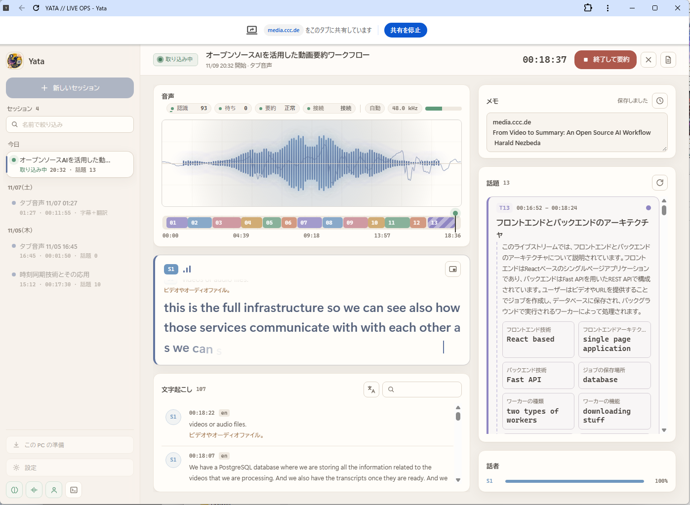

# Yata

Yata は、ブラウザのタブで流れているライブ配信の音声を聞き取り、字幕を出し、話題の区切りごとに要約するローカルアプリです（Windows・macOS・Linux）。音声認識・話題の区切り・要約・翻訳は、すべてこの PC の中で動きます。

- **字幕**：faster-whisper（または Qwen3-ASR）で、話している途中から字幕を表示します。
- **話題ごとの要約**：話題が変わったところで区切り、指定した言語で要約します。要約の各ポイントには根拠となる字幕の行が付き、数値が元の発言と食い違うものは「要確認」として分けて表示します。
- **字幕の翻訳**：要約に使う LLM、または翻訳専用モデル PLaMo 3 Translate で字幕を訳します。
- **話者ラベル**：声の特徴から S1、S2… と話者を区別します（目安です）。
- **保存と書き出し**：セッションは自動で保存され、Markdown で書き出せます。

ブラウザ拡張は不要です。Yata のページが Chrome の「タブを共有」機能で音声を受け取ります。サーバーは `127.0.0.1` だけで待ち受けます。

## クイックスタート

公式の配布元から入手したファイルだけを実行してください。Windows や macOS の警告を解除する前に、入手元と内容を確認してください。

1. **Yata のフォルダを用意します。** GitHub のこのページで **Code → Download ZIP** を押し、zip を好きな場所に展開します（`git clone` でも構いません）。
2. **起動用のファイルを開きます。**
   - **Windows**：`start-windows.cmd` をダブルクリックします。「Windows によって PC が保護されました」と出たら **詳細情報 → 実行** を押します。
   - **macOS**（Apple シリコン、macOS 14 以降）：`start-mac.command` をダブルクリックします。「開発元を確認できない」と出たら、control キーを押しながらクリックして **開く** を選びます。
   - **Linux**：ターミナルで Yata のフォルダに移動し、`sh start-mac-linux.sh` を実行します（macOS でも使えます）。
3. **質問に答えます。** 初回だけ、準備ツール uv を入れてよいか聞かれます（Enter で「はい」）。NVIDIA の GPU がある PC では、GPU 用の部品を入れるかも聞かれます。そのあと Python と必要な部品が入ります（数分かかります。2 回目からはすぐ起動します）。
4. **ブラウザでページが開きます。** 最初は「この PC の準備」が開きます。使い方を選び、おすすめのモデルの「準備する」を押し、準備ができたら「取り込みを始める」を押します。
5. **終わるとき**は、起動したウィンドウで **Ctrl+C** を押すか、ウィンドウを閉じます。次からは手順 2 だけで起動できます。

管理者権限は使いません。アプリの仮想環境は Yata のフォルダ内の `.venv` に作られます。uv 本体、uv が管理する Python、ダウンロードのキャッシュはユーザーフォルダ側に作られます。

## 動作環境

| 使用ツール/OS | 説明 |
|---|---|
| ブラウザ | **Google Chrome** または **Microsoft Edge**（タブの音声を共有するため）。字幕の小窓（ピクチャー・イン・ピクチャー）は Chrome 116 以降 |
| Windows | x64（Windows 11 で確認）。NVIDIA GPU があれば、音声認識に CUDA を使います |
| macOS | Apple シリコン、macOS 14 以降。音声認識は CPU で動きます |
| Linux | 音声認識は CPU、または NVIDIA GPU（CUDA） |

- 音声認識は、NVIDIA GPU で CUDA が使えれば whisper-large-v3-turbo（話している途中の字幕あり）、なければ whisper-small の int8 版（話し終わってから字幕を表示）を使います。
- 要約にはローカル LLM が必要です。字幕だけなら要りません。LLM は、内蔵の llama.cpp、Ollama、この PC で動く OpenAI 互換サーバー、Microsoft Foundry Local から選べます。
- macOS と Linux で内蔵の LLM や PLaMo を使うには、`llama-server` を `PATH` に入れるか（macOS なら `brew install llama.cpp`）、`YATA_LLAMA_SERVER` で場所を指定してください。準備画面が実行環境を取得するのは Windows だけです。
- 取り込めるのはブラウザで共有できる音声です。デスクトップアプリの音声は、ブラウザと OS が画面共有で音声を渡せる場合だけ取り込めます。

## 使い方

1. **この PC の準備**：PC の性能（CPU、メモリ、GPU、空き容量）を調べ、「字幕のみ」「字幕＋翻訳」「字幕＋要約・翻訳」から使い方を選びます。足りないモデルは「準備する」で取得し、読み込みテストに通ると「準備完了」になります。
2. **新しいセッション**：配信の言語・要約の言語・字幕の翻訳先・要約のモデルを選び、丸いボタンを押します。共有ダイアログで配信を流しているタブを選び、「タブの音声を含めて共有する」をオンにします。
3. **取り込み中**：字幕・文字起こし・話題ごとの要約が画面に流れます。メモを書いたり、Markdown で書き出したりできます。
4. **終了**：「終了して要約」で最後の話題を要約し、全体のまとめを作ります。終わったセッションは「続きを取り込む」で再開できます。

詳しくは [使い方ガイド](docs/usage.md) を参照してください。

## データとプライバシー

- 音声はメモリ上で処理するだけで、録音しません。
- 字幕・要約・翻訳・メモは、この PC に保存されます。保存先は次のとおりです（モデルと設定も同じ場所です）。
  - Windows：`%LOCALAPPDATA%\Yata`
  - macOS：`~/Library/Application Support/Yata`
  - Linux：`~/.local/share/Yata`
- LLM との通信は、この PC 内のアドレス（ループバック）に限っています。プロキシもリダイレクトも使いません。

Yata がインターネットに接続するのは次の場合です。

- uv・Python・パッケージのインストール（初回の起動時）
- 準備画面で「準備する」を押したときのモデル・実行環境の取得（Hugging Face または GitHub から。サイズとハッシュを固定して検証します）。Ollama と Foundry Local は、それぞれ自分でモデルを取得します
- Slack への送信（機能を有効にし、Webhook を設定し、セッションごとに送信を選んだ場合だけ。送るのは検証済みの要約だけで、音声や字幕の行は送りません）
- 利用者が開いたリンク（配布元やライセンスのページなど）

これは Yata が意図している通信の一覧です。同梱しているライブラリの通信まで、すべてを監査したものではありません。詳しくは [構成とセキュリティ](docs/architecture.md) を参照してください。

## 注意点

- 字幕・翻訳・話者ラベル・要約は間違えることがあります。要約を使う前に、根拠として示された元の字幕を確認してください。翻訳は読むための補助で、要約の根拠には使いません。
- PLaMo 3 Translate には、仕事での利用や訳文の公開に条件があります（[使い方ガイド](docs/usage.md#字幕の翻訳plamo) を参照）。
- 動作を確認した環境は限られています。確認済みの範囲と残っている項目は [開発ガイド](docs/development.md#手動で確認すること) にまとめています。

## ポータブル版（Windows）

Python や uv をインストールせずに `Yata.cmd` で起動できるフォルダを作れます。CPU 版と GPU 版（CUDA 12 の cuBLAS を同梱）があります。作り方は [開発ガイド](docs/development.md#ポータブル版のビルド) を参照してください。配布する前に、同梱ライブラリのライセンス条件について [配布前に解決すること](docs/development.md#配布前に解決すること) を確認する必要があります。

## ドキュメント

- [使い方ガイド](docs/usage.md)：準備画面、要約の LLM、字幕の翻訳、画面の操作、保存と削除
- [開発ガイド](docs/development.md)：ソースからの起動、設定、テスト、ポータブル版のビルド
- [構成とセキュリティ](docs/architecture.md)：処理の流れ、信頼境界、保存するもの
- [性能と測定方法](docs/performance.md)：音声認識・翻訳の測定結果と再計測の手順

## ライセンス

Yata は [MIT License](LICENSE) で公開しています。モデルと外部の実行環境はそれぞれのライセンスに従います。準備画面は、取得する前に各モデルのライセンスを表示します。

ポータブル版に同梱するパッケージと実行環境のライセンスは [THIRD_PARTY_NOTICES.md](THIRD_PARTY_NOTICES.md) と [licenses/](licenses/) にまとめています。ポータブル版を作り直したり配布したりするときは、これらを一緒に含めてください。Yata 自身の MIT License は、第三者のライセンス条件を置き換えるものではありません。
